# Implementacija koncepata interakcije s korisnikom u iOS aplikacijama

Ovaj tutorial uključuje teorijske i praktične aspekte interakcije aplikacije i korisnika, odnosno prikazuje kako iOS aplikacija može slati poruke korisniku i kako korisnik može reagirati na njih. Svaki koncept je prvo teorijski objašnjen s preporukama za dizajn, a zatim implementiran u SwiftUI-ju.

<hr/>

**Kolegij**: Razvoj aplikacija za mobilne i pametne uređaje

**Nositelj**: Izv. prof. dr. sc. Zlatko Stapić

**Suradnik**: univ. mag. inf. Dario Ljubas


**Autor**: Luka Srbljinović


## Sadržaj
1. [Uvod](#uvod)
2. [Početni projekt](#početni-projekt)
3. [Početna navigacija](#početna-navigacija)
4. [Korak 1: Dijalozi](#korak-1-dijalozi)
5. [Korak 2: Toast](#korak-2-toast)
6. [Korak 3: Snackbar](#korak-3-snackbar)
7. [Korak 4: FAB](#korak-4-fab)
8. [Korak 5: Sistemske notifikacije](#korak-5-sistemske-notifikacije)
9. [Zaključak](#zaključak)
10. [Literatura](#literatura)

## Uvod

Aplikacija stalno komunicira s korisnikom na različite načine:
- potvrđuje da je neka radnja uspjela
- potvrđuje da nije uspjela odnosno javlja grešku
- traži potvrdu za brisanje podataka
- traži potvrdu za nastavak dalje u nekom koraku...

Važno je ispravno implementirati koncepte interakcije tako da manje važne poruke ne prekidaju rad korisnika te tako negativno utječu na korisničko iskustvo, a s druge strane osigurati da važne poruke ne prođu neprimijećeno.

Poruke korisniku možemo podijeliti u dvije skupine:

**Poruke unutar aplikacije** prikazuju se dok korisnik koristi aplikaciju:
- **Dijalozi**: prekidaju rad i traže odgovor korisnika (npr. potvrda brisanja).
- **Toast**: nemodalna poruka koja sama nestaje (npr. „Spremljeno“).
- **Snackbar**: sličan toastu, ali nudi i jednu akciju (npr. „Poruka obrisana – Poništi“).
- **FAB** (Floating Action Button) je istaknuti gumb za glavnu radnju na ekranu.

**Sistemske notifikacije**: prikazuje operacijski sustav, pa stižu i kad aplikacija nije otvorena. U ovom tutorijalu obrađujemo lokalne notifikacije u dvije verzije: jednostavnu i složenu (o tome više riječi u koraku #5)

Toast, snackbar i FAB potječu iz Androida i Material Designa
te nemaju gotovu komponentu u iOS-u. U tutorialu ih zato
implementiramo kao vlastite komponente, uz preporuke iz
Apple Human Interface Guidelines i Material Designa.

Detaljnija objašnjenja slijede u daljnjim koracima tutorijala.

_**Napomena:** Tutorijal se usredotočuje na interakciju aplikacija s korisnikom. osnove jezika Swift i osnove SwiftUI-ja neće se detaljno objašnjavati jer nisu dio ove teme te se pretpostavlja da ih čitatelj već razumije. Objašnjavaju se samo dijelovi koji su izravno vezani uz temu._

## Početni projekt

Kako bi mogli pratiti tutorial, potrebno je kreirati novi projekt:
1. Otvori Xcode i odaberi **File -> New -> Project...**
2. Pod **iOS** odaberi predložak **App** i klikni **Next**.
3. Ispuni sljedeće postavke projekta:

| Postavka | Vrijednost | Objašnjenje |
|---|---|---|
| Product Name | UserInterfaceDemo (može biti proizvoljno) | ime aplikacije i projekta |
| Interface | SwiftUI | framework za izradu sučelja |
| Language | Swift | |
| Storage | None | aplikacija ne sprema podatke |

4. Odaberi mapu u kojoj će se projekt spremiti i klikni **Create**

### Početna struktura projeta

```text
interakcija_s_korisnikom/
├── README.md
├── .gitignore
└── UserInterfaceDemo/
    ├── UserInterfaceDemo.xcodeproj
    └── UserInterfaceDemo/
        ├── UserInterfaceDemoApp.swift
        ├── ContentView.swift
        ├── Assets.xcassets/
        └── Preview Content/
            └── Preview Assets.xcassets
```

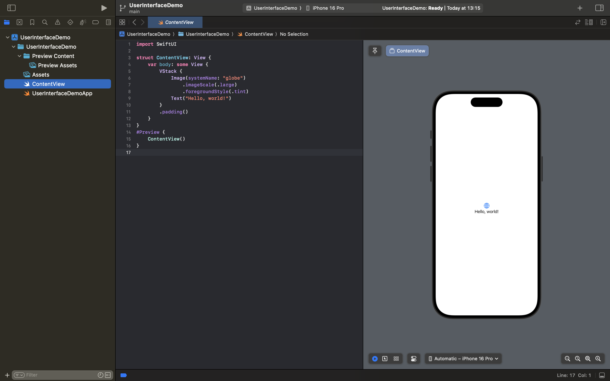

#### ContentView.swift
```swift
import SwiftUI

struct ContentView: View {
    var body: some View {
        VStack {
            Image(systemName: "globe")
                .imageScale(.large)
                .foregroundStyle(.tint)
            Text("Hello, world!")
        }
        .padding()
    }
}
#Preview {
    ContentView()
}

```

#### UserInterfaceDemoApp.swift
```swift
import SwiftUI

@main
struct UserInterfaceDemoApp: App {
    var body: some Scene {
        WindowGroup {
            ContentView()
        }
    }
}
```

Dakle trebali bi imati ovakvu strukturu, izgled prvog ekrana i programski kod navedenih datoteka prije nego se krene sa samim objašnjavanjem teme ovog tutorijala.


## Početna navigacija

Prije implementacije pojedinih koncepata potrebno je napraviti početni ekran s kojeg se može doći do svakog primjera. Svaki koncept dobiva vlastiti ekran, tako da je kod pregledan i primjeri su međusobno odvojeni. To je implementirano tako da je na početnom ekranu napravljena jednostavna navigacija koja vodi do svakog primjera i nazad.

### 1. Mapa za ekrane

Kako bi projekt ostao organiziran, svi se ekrani spremaju u zajedničku mapu. U gornjem lijevom stupcu napravi klik na mapu _UserInterfaceDemo_ i odaberi **New Folder** te je nazovi _Screens_. Također napravi i mape _Components_ i _Notifications_ koje ćemo koristiti kasnije za toast, snackbar i FAB kao komponente koje se mogu ponovo koristiti te za logiku notifikacija.

### 2. Prazni ekrani

Za svaki koncept napravi prazan ekran koji će se popunjavati u sljedećim
koracima. Desni klik na mapu _Screens_ → **New File from Template…** →
**SwiftUI View**.

Napravi sljedeće datoteke:

| Datoteka | Koncept |
|---|---|
| _DialogsScreen.swift_ | korisnički dijalozi |
| _ToastScreen.swift_ | toast poruke |
| _SnackbarScreen.swift_ | snackbar poruke |
| _FABScreen.swift_ | Floating Action Button |
| _SimpleNotificationScreen.swift_ | jednostavna sistemska notifikacija |
| _RichNotificationScreen.swift_ | složena sistemska notifikacija |

Sada bi stablo direktorija trebalo izgledati ovako: 

```text
interakcija_s_korisnikom/
├── README.md
├── .gitignore
├── images/
└── UserInterfaceDemo/
    ├── UserInterfaceDemo.xcodeproj
    └── UserInterfaceDemo/
        ├── UserInterfaceDemoApp.swift
        ├── ContentView.swift
        ├── Components/
        ├── Notifications/
        ├── Screens/
        │   ├── DialogsScreen.swift
        │   ├── ToastScreen.swift
        │   ├── SnackbarScreen.swift
        │   ├── FABScreen.swift
        │   ├── SimpleNotificationScreen.swift
        │   └── RichNotificationScreen.swift
        ├── Assets.xcassets/
        └── Preview Content/
            └── Preview Assets.xcassets
```

Svaki ekran za sada sadrži samo tekst i naslov: 
```swift
import SwiftUI

struct DialogsScreen: View {
    var body: some View {
        Text("Ovdje dolaze primjeri dijaloga.")
            .navigationTitle("Dijalozi")
    }
}

#Preview {
    NavigationStack {
        DialogsScreen()
    }
}
```
_.navigationTitle_ postavlja naslov koji se prikazuje u navigacijskoj traci kad se ekran otvori.
U _#Preview_ je ekran omotan u _NavigationStack_ kako bi se naslov vidio i u Canvasu s desne strane.

Ostale ekrane napravi na sličan način, dakle mijenjaj samo naziv structa, tekst i naslov, npr. za FABScreen promijeni _struct DialogsScreen:_ u _struct FABScreen:_...

### 3. Navigacija pomoću NavigationStack

Početni ekran (_ContentView_) prikazuje listu primjera u obliku jednostavne navigacije koja je implementirana pomoću _NavigationStack_. 

ContentView.swift

```swift
import SwiftUI

struct ContentView: View {
    var body: some View {
        NavigationStack {
            List {
                Section("Poruke unutar aplikacije") {
                    NavigationLink {
                        DialogsScreen()
                    } label: {
                        Label("Dijalozi", systemImage: "exclamationmark.bubble")
                    }

                    NavigationLink {
                        ToastScreen()
                    } label: {
                        Label("Toast", systemImage: "text.bubble")
                    }

                    NavigationLink {
                        SnackbarScreen()
                    } label: {
                        Label("Snackbar", systemImage: "square.bottomhalf.filled")
                    }

                    NavigationLink {
                        FABScreen()
                    } label: {
                        Label("FAB", systemImage: "plus.circle.fill")
                    }
                }

                Section("Sistemske notifikacije") {
                    NavigationLink {
                        SimpleNotificationScreen()
                    } label: {
                        Label("Jednostavna notifikacija", systemImage: "bell")
                    }

                    NavigationLink {
                        RichNotificationScreen()
                    } label: {
                        Label("Složena notifikacija", systemImage: "bell.badge")
                    }
                }
            }
            .navigationTitle("Interakcija s korisnikom")
        }
    }
}

#Preview {
    ContentView()
}
```
Dakle _NavigationStack_ upravlja navigacijom tako da kad korisnik otvori novi ekran on se postavlja na vrh stoga, a gumb za povratak (gore lijevo) ga uklanja. Gumb se dodaje automatski. 

_List_ prikazuje retke u obliku obične iOS liste.

_NavigationLink_ je redak koji na dodir otvara novi ekran. Prvi dio određuje odredište, npr. _DialogsScreen()_, a _Label_ ono što se prikazuje u retku. _Label_ prikazuje tekst s ikonom, a koje dolaze iz Appleove biblioteke **SF Symbols**.

Također, koristeći _Section_, u svrhu jednostavnijeg praćenja, primjeri su podijeljeni u dvije skupine: Poruke unutar aplikacije i Sistemske notifikacije.

Na kraju, pokrenemo aplikaciju koja treba izgledati prema sljedećim slikama:

<p align="center">
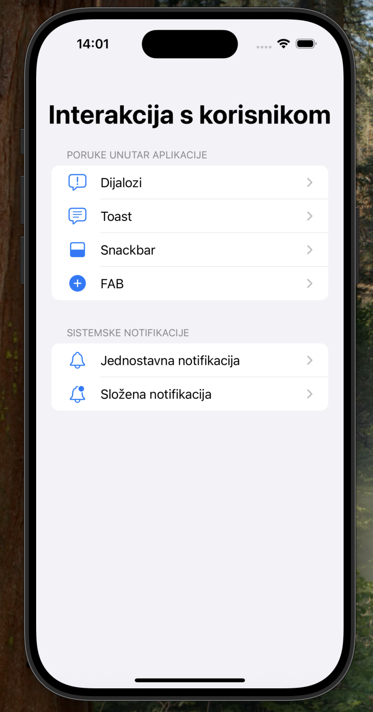 
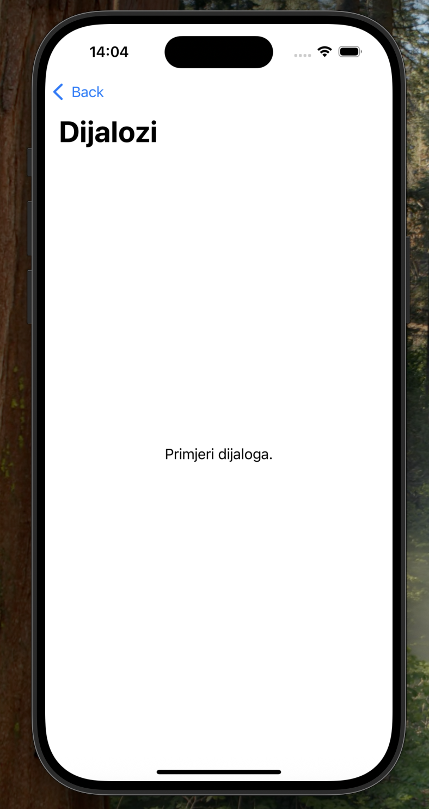 
</p>

Sad kada smo pripremili početnu aplikaciju, možemo krenuti s primjerima.

[↑ Natrag na sadržaj](#sadržaj)

## Korak 1: Dijalozi

Dijalog je **modalni** element sučelja koji se prikazuje iznad trenutnog sadržaja i prekida korisnika dok ne odgovori ili ga ne zatvori. Stoga može biti vrlo koristan, ali i nametljiv. Koristi se kada aplikacija treba korisniku reći nešto važno ili od njega tražiti odluku prije nego nastavi.

U iOS-u postoje tri osnovna oblika dijaloga: 
| Vrsta | Izgled | Kada se koristi | SwiftUi |
|---|---|---|---|
| **Alert** | mali okvir u sredini ekrana | važna informacija ili potvrda radnje | _.alert_|
| **Action sheet** (**Donfirmation Dialog**) | izbornik koji izlazi s dna ekrana | izbor između više radnji vezanih uz radnju koju je korisnik pokrenuo | _.confirmationDialog_ |
| **Sheet** | ploča preko dijela ili cijelog ekrana | kratak, zaokružen zadatak vezan uz trenutni kontekst (npr. obrazac) | _.sheet_ |

### Preporuke dizajna

Preporuke su preuzete iz Apple Human Interface Guidelines.
_(Poveznica u sekciji [Literatura](#sadržaj) )_

**Alert**
- Koristi ga štedljivo. Alert prekida korisnika, pa svaki treba sadržavati samo bitne informacije i korisne radnje. Ako se alerti pojavljuju prečesto, korisnici ih počnu zatvarati bez čitanja.
- Ne prikazuj alert za česte radnje koje se mogu poništiti, čak ni kad su destruktivne. Primjer: brisanje e-maila ne traži potvrdu jer se može vratiti iz smeća.
- Alert ima naslov, neobavezni tekst poruke i najviše tri gumba. Na iOS-u može sadržavati i polje za unos teksta.
- Nazivi gumba trebaju biti kratki (jedna ili dvije riječi) i opisivati rezultat: „Obriši“ je bolje od „Da“.
- Ako korisnik bira između više od dva izbora, bolje je koristiti action sheet.

**Action Sheet** (**Confirmation Dialog**)
- Koristi ga za izbore vezane uz radnju koju je korisnik sam pokrenuo. Primjer: kad korisnik zatvara nedovršenu poruku, nudi se „Spremi skicu“ ili „Obriši skicu“.
- Gumb za odustajanje nalazi se na dnu. U SwiftUI-ju ga confirmation dialog dodaje automatski.
- Uz gumb za odustajanje ponudi najviše tri dodatna izbora.

**Sheet**
- Koristi ga za kratak zadatak usko vezan uz trenutni kontekst, npr. unos komentara ili uređivanje jednog podatka.
- Sheet treba imati gumb za odustajanje koji ga zatvara bez spremanja promjena.

**Uloge gumba**

SwiftUI gumbima može dodijeliti ulogu (_role_):
- _.destructive_ – gumb briše podatke ili izvodi nepovratnu radnju, a sustav ga prikazuje crveno
- _.cancel_ – gumb zatvara dijalog bez ikakve radnje; sustav ga sam postavlja na uobičajeno mjesto

Zahvaljujući ulogama, dijalozi automatski prate sistemski izgled i ponašanje, a korisnik odmah prepoznaje opasnu radnju.

### Korak 1.1: Priprema ekrana

 🔗 [Commit za ovaj korak](https://github.com/lsrbljino24/interakcija_s_korisnikom/commit/ecf5fc0)

Ekran _DialogsScreen_ prikazuje listu gumba, a svaki otvara jedan primjer dijaloga. Na dnu se prikazuje zadnja reakcija korisnika, kako bi se vidjelo koji je gumb u dijalogu odabran.

Dakle pripremi DialogsScreen.swift kako je prikazano ispod:
```swift
import SwiftUI

struct DialogsScreen: View {
    // varijable stanja idu ovdje
    @State private var lastAction = "Još nije odabrana nijedna radnja."

    var body: some View {
        List {
            // gumbi na ekranu idu ovdje
            Section("Zadnja reakcija korisnika") {
                Text(lastAction)
                    .foregroundStyle(.secondary)
            }
        }
        .navigationTitle("Dijalozi")
        // dijalozi idu ovdje
    }
}
```
Svaki dijalog u SwiftUI-ju prikazuje se na isti način:
1. varijabla stanja tipa _Bool_ određuje je li dijalog vidljiv
2. gumb na ekranu postavlja tu varijablu na _true_
3. modifikator dijaloga (_.alert_, _.confirmationDialog_, _.sheet_) prima tu varijablu kao **binding** (_$_) i prikazuje dijalog
4. kad korisnik odabere gumb u dijalogu, SwiftUI sam vraća varijablu na _false_ i zatvara dijalog

U sljedeća tri koraka su objašnjena tri tipa Alerta.

### Korak 1.2: Informativni alert

🔗 [Commit za ovaj korak](https://github.com/lsrbljino24/interakcija_s_korisnikom/commit/48b9d4d)

Najjednostavniji alert koji obavještava korisnika o važnom događaju i ima samo jedan gumb.

Dodaj varijablu stanja:
```swift
@State private var showInfoAlert = false
```

Dodaj sekciju s gumbom na vrh liste:
```swift
Section("Alert") {
    Button("Informativni alert") {
        showInfoAlert = true
    }
}
```

Dodaj modifikator nakon _.navigationTitle_:
```swift
.alert("Nema internetske veze", isPresented: $showInfoAlert) {
    Button("U redu") {
        lastAction = "Korisnik je potvrdio informativni alert."
    }
} message: {
    Text("Provjerite vezu i pokušajte ponovno.")
}
```
- Prvi parametar je **naslov** alerta.
- _isPresented: $showInfoAlert_ povezuje alert s varijablom stanja.
- U prvom bloku su **gumbi**, a u bloku _message_ **tekst poruke**.

Primjer prati preporuku da alert sadrži važnu informaciju, dakle korisnik mora znati da nema internetske veze jer o tome ovisi što može dalje raditi.

Kako bi testirali implementirani kod, navigiramo se s početnog ekrana u sekciju _Dijalozi_ nakon čega odaberemo opciju _Informativni alert_ što nam prikaže sami alert na kojemu odaberemo opciju _U redu_. Možemo primijetiti kako se u _Zadnju reakciju korisnika_ upiše _Korisnik je potvrdio informativni alert_

<p align="center">
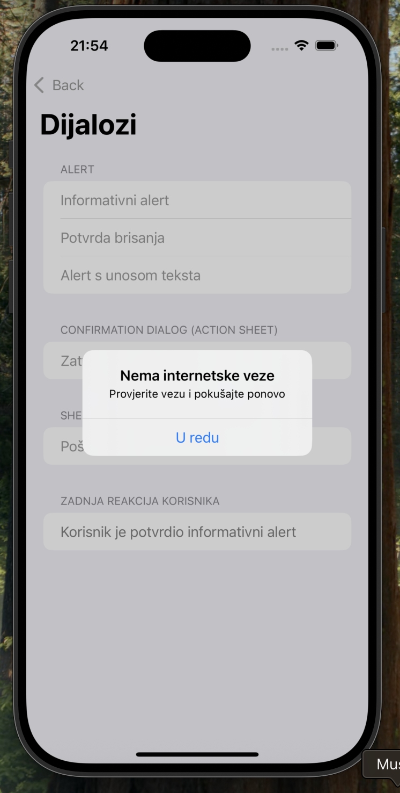
</p>

### Korak 1.3: Alert za potvrdu destruktivne radnje

🔗 [Commit za ovaj korak](https://github.com/lsrbljino24/interakcija_s_korisnikom/commit/cfce10c)

Kada radnja nepovratno briše podatke, alert traži potvrdu korisnika.

```swift
@State private var showDeleteAlert = false
```

```swift
Button("Potvrda brisanja") {
    showDeleteAlert = true
}
```

```swift
.alert("Obrisati fotografiju?", isPresented: $showDeleteAlert) {
    Button("Obriši", role: .destructive) {
        lastAction = "Korisnik je obrisao fotografiju."
    }
    Button("Odustani", role: .cancel) {
        lastAction = "Korisnik je odustao od brisanja."
    }
} message: {
    Text("Ova radnja se ne može poništiti.")
}
```

- _role: .destructive_ prikazuje gumb crveno i upozorava korisnika.
- _role: .cancel_ označava gumb za odustajanje. Sustav ga sam postavlja na uobičajeno mjesto, bez obzira na redoslijed u kodu.
- Gumbi su nazvani prema rezultatu („Obriši“, „Odustani“), a ne „Da“ i „Ne“.

<p align="center">
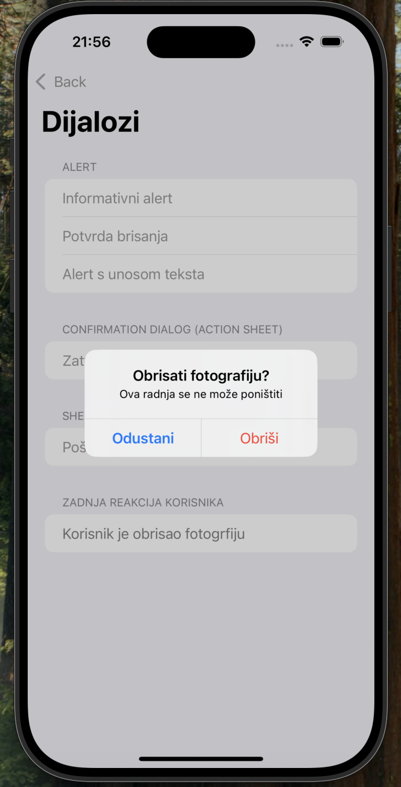
</p>

### Korak 1.4: Alert s unosom teksta

🔗 [Commit za ovaj korak](https://github.com/lsrbljino24/interakcija_s_korisnikom/commit/906ee3a)

Na iOS-u alert može sadržavati polje za unos teksta, što je korisno za kratak unos poput novog naziva.

```swift
@State private var showRenameAlert = false
@State private var newName = ""
```

```swift
Button("Alert s unosom teksta") {
    newName = ""
    showRenameAlert = true
}
```

```swift
.alert("Preimenuj album", isPresented: $showRenameAlert) {
    TextField("Novi naziv", text: $newName)
    Button("Spremi") {
        lastAction = "Novi naziv albuma: \(newName)"
    }
    Button("Odustani", role: .cancel) {
        lastAction = "Korisnik je odustao od preimenovanja."
    }
} message: {
    Text("Unesite novi naziv albuma.")
}
```

- _TextField_ unutar bloka gumba prikazuje polje za unos u alertu.
- Tekst se sprema u varijablu _newName_ preko bindinga _$newName_.
- Prije otvaranja alerta polje se prazni, kako ne bi ostao tekst od prošlog unosa.

<p align="center">
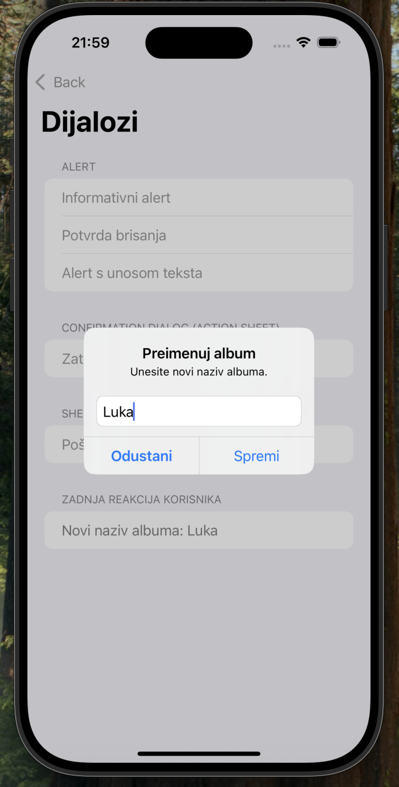
</p>

### Korak 1.5: Confirmation dialog (action sheet)

🔗 [Commit za ovaj korak](https://github.com/lsrbljino24/interakcija_s_korisnikom/commit/e014252)

Kada korisnik pokrene radnju koja ima više mogućih ishoda, koristi se confirmation dialog, koji se na iPhoneu prikazuje kao action sheet s dna ekrana.

```swift
@State private var showDraftDialog = false
```

```swift
Section("Confirmation dialog") {
    Button("Zatvori skicu poruke") {
        showDraftDialog = true
    }
}
```

```swift
.confirmationDialog(
    "Što želite napraviti sa skicom?",
    isPresented: $showDraftDialog,
    titleVisibility: .visible
) {
    Button("Spremi skicu") {
        lastAction = "Skica je spremljena."
    }
    Button("Obriši skicu", role: .destructive) {
        lastAction = "Skica je obrisana."
    }
    Button("Odustani", role: .cancel) {
        lastAction = "Korisnik je nastavio uređivati poruku."
    }
} message: {
    Text("Poruka još nije poslana.")
}
```
- Naslov se na iPhoneu po defaultu ne prikazuje, pa ga _titleVisibility: .visible_ uključuje.
- Gumb s ulogom _.cancel_ prikazuje se odvojeno na dnu. Kad bi se izostavio, SwiftUI bi ga dodao automatski.
- Primjer ima dva izbora uz odustajanje, što je unutar preporučenog broja izbora.

<p align="center">
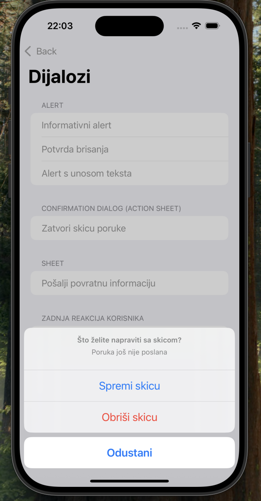
</p>

### Korak 1.6: Sheet

🔗 [Commit za ovaj korak](https://github.com/lsrbljino24/interakcija_s_korisnikom/commit/a53d6a6)

Sheet se koristi kada dijalog sadrži više od par gumba, npr. obrazac.

```swift
@State private var showSheet = false
@State private var comment = ""
```

```swift
Section("Sheet") {
    Button("Pošalji povratnu informaciju") {
        comment = ""
        showSheet = true
    }
}
```

```swift
.sheet(isPresented: $showSheet) {
    NavigationStack {
        Form {
            TextField("Vaš komentar", text: $comment, axis: .vertical)
        }
        .navigationTitle("Povratna informacija")
        .navigationBarTitleDisplayMode(.inline)
        .toolbar {
            ToolbarItem(placement: .cancellationAction) {
                Button("Odustani") {
                    lastAction = "Korisnik je odustao od slanja komentara."
                    showSheet = false
                }
            }
            ToolbarItem(placement: .confirmationAction) {
                Button("Pošalji") {
                    lastAction = "Poslan komentar: \(comment)"
                    showSheet = false
                }
                .disabled(comment.isEmpty)
            }
        }
    }
    .presentationDetents([.medium])
}
```

- Sadržaj sheeta je običan SwiftUI view, pa može sadržavati bilo što.
- Za razliku od alerta, sheet se ne zatvara sam, nego ga zatvara postavljanje _showSheet = false_.
- _.cancellationAction_ i _.confirmationAction_ postavljaju gumbe na uobičajena mjesta u navigacijskoj traci (lijevo odustajanje, desno potvrda).
- _.disabled(comment.isEmpty)_ onemogućuje slanje praznog komentara.
- _.presentationDetents([.medium])_ prikazuje sheet preko pola ekrana, tako da korisnik i dalje vidi kontekst ispod njega.

<p align="center">
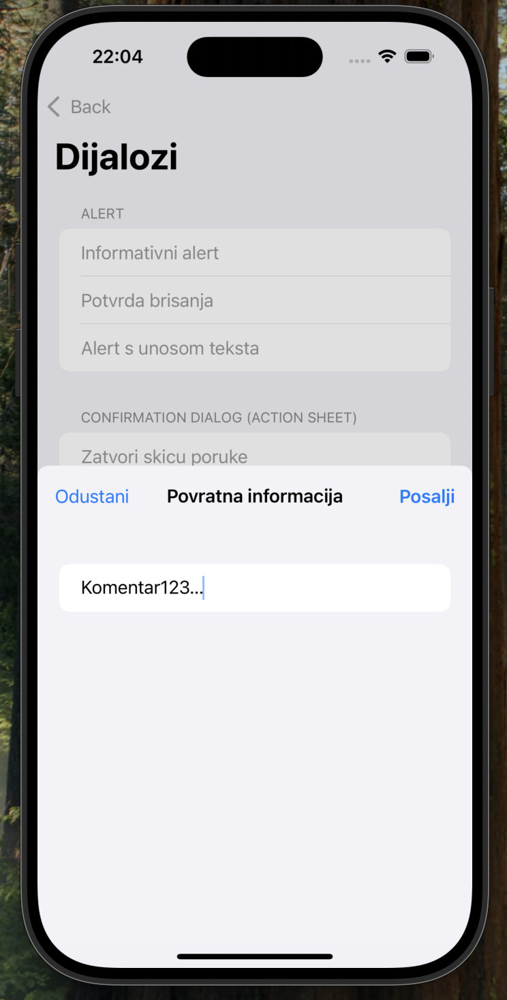
</p>

### Završni izgled ekrana


| Dijalozi ekran | Alert brisanje | Confirmation dialog | Sheet |
|---|---|---|---|
| 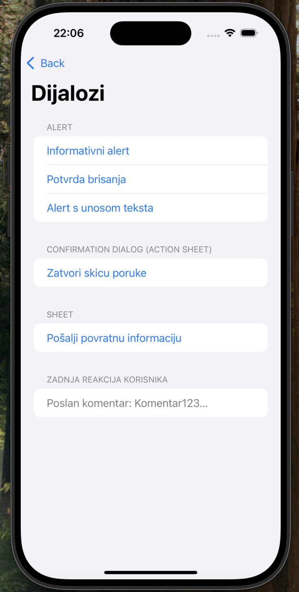 |  |  |  |


[↑ Natrag na sadržaj](#sadržaj)

## Korak 2: Toast

Toast je kratka poruka koja korisniku daje povratnu informaciju o radnji koju je upravo napravio, npr. "Poveznica je kopirana" ili "Spremljeno u favorite". Prikazuje se u malom okviru, zauzima samo onoliko mjesta koliko treba tekstu i nestaje nakon nekoliko sekundi.

Za razliku od dijaloga, toast je **nemodalan**: ne prekida korisnika, ne traži nikakvu reakciju, a ostatak ekrana cijelo vrijeme ostaje vidljiv i upotrebljiv.

Toast potječe iz Androida gdje postoji kao gotova komponenta. iOS nema takvu komponentu pa ga je potrebno implementirati kao vlastiti view.

**Usporedba s ostalim načinima obavještavanja:**

| | Toast | Snackbar | Alert | Notifikacija |
|---|---|---|---|---|
| Prekida korisnika | ne | ne | da | ne |
| Nudi akciju | ne | da (jednu) | da | da |
| Nestaje sam | da | da | ne | ne |
| Radi kad aplikacija nije otvorena | ne | ne | ne | da |

### Preporuke dizajna

Apple Human Interface Guidelines ne opisuju toast, pa se preporuke temelje na Androidovoj dokumentaciji prilagođene iOS-u:

- **Samo za kratku povratnu informaciju.** Toast potvrđuje da se nešto dogodilo. Ne koristi ga za važne informacije, jer ga korisnik lako može propustiti.
- **Kratak tekst.** Najviše jedan do dva retka. Android od verzije 12 ograničava toast na dva retka.
- **Bez akcija.** Ako korisnik treba moći reagirati (npr. poništiti brisanje), koristi snackbar. Ako je informacija ključna, koristi alert. Ako aplikacija nije otvorena, koristi notifikaciju.
- **Ne zaklanjaj sadržaj.** Toast se prikazuje na dnu ekrana, iznad sadržaja, i ne smije prekrivati važne kontrole.
- **Jedan toast odjednom.** Nova poruka zamjenjuje prethodnu.
- **Pristupačnost.** Korisnik koji koristi VoiceOver ne vidi toast pa se njegov tekst mora i izgovoriti.

### Korak 2.1: Model poruke

🔗 [Commit za ovaj korak](https://github.com/lsrbljino24/interakcija_s_korisnikom/commit/1c4991e)

U već napravljenoj mapi _Components_ napravi novu Swift datoteku _Toast.swift_  (označi mapu _Components_ → **+** u donjem lijevom kutu → **New File from Template…** → **Swift File**)

Za početak napiši sljedeći kod:

Toast.swift
```swift
import SwiftUI

struct Toast: Equatable {
    let id = UUID()
    let message: String
    var systemImage: String = "checkmark.circle.fill"
}
```
- _message_ je tekst poruke, a _systemImage_ naziv ikone iz SF Symbols. Ako se ikona ne navede, koristi se kvačica.
- _id_ je jedinstvena oznaka svake poruke. Pomoću nje se dvije poruke s istim tekstom smatraju različitima, pa se vrijeme prikaza ponovno pokreće kad korisnik istu radnju napravi dvaput. Generira se pomoću _UUID_.
- _Equatable_ omogućuje SwiftUI-ju da uspoređuje poruke i prepozna kad se pojavila nova.

### Korak 2.2: Izgled toasta

🔗 [Commit za ovaj korak](https://github.com/lsrbljino24/interakcija_s_korisnikom/commit/1f1363a)


U istu datoteku, ispod structa _Toast_, dodaj view koji crta poruku:
  
```swift
  
struct ToastView: View {
    let toast: Toast

    var body: some View {
        Label(toast.message, systemImage: toast.systemImage)
            .font(.subheadline)
            .padding(.horizontal, 16)
            .padding(.vertical, 12)
            .background(.regularMaterial, in: Capsule())
            .shadow(radius: 4, y: 2)
    }
}

#Preview {
    ToastView(toast: Toast(message: "Postavke su spremljene"))
}

```
- _Label_ prikazuje ikonu i tekst jedno pokraj drugog.
- _.font(.subheadline)_ koristi sistemski stil teksta, pa se veličina automatski prilagođava postavci veličine teksta na uređaju.
- _.regularMaterial_ je poluprozirna sistemska pozadina koja se sama prilagođava svijetlom i tamnom načinu rada.
- _Capsule()_ daje okvir zaobljenih rubova, a _.shadow_ blagu sjenu koja odvaja toast od sadržaja ispod njega.
- _#Preview_ nam daje uvid u izgled toasta s desne strane kako bi ga lakše dizajnirali

<p align="center">
  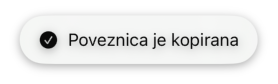
  <br>
  <span>Izgled toasta</span>
</p>

### Korak 2.3: Prikaz na ekranu

🔗 [Commit za ovaj korak](https://github.com/lsrbljino24/interakcija_s_korisnikom/commit/809f783)


Toast se mora moći prikazati na bilo kojem ekranu. Zato se izrađuje kao **ViewModifier**. To je dodatak koji se može primijeniti na bilo koji view.

U istu datoteku dodaj:
```swift
struct ToastModifier: ViewModifier {
    @Binding var toast: Toast?

    func body(content: Content) -> some View {
        content
            .overlay(alignment: .bottom) {
                if let toast {
                    ToastView(toast: toast)
                        .padding(.bottom, 32)
                        .transition(.move(edge: .bottom).combined(with: .opacity))
                }
            }
            .animation(.easeInOut(duration: 0.3), value: toast)
    }
}

extension View {
    func toast(_ toast: Binding<Toast?>) -> some View {
        modifier(ToastModifier(toast: toast))
    }
}
```

- _@Binding var toast: Toast?_ povezuje modifikator s varijablom na ekranu. Kad je vrijednost _nil_ toast nije prikazan, a kad se postavi poruka toast se pojavi.
- _.overlay(alignment: .bottom)_ crta toast iznad sadržaja ekrana pri dnu bez pomicanja ostalih elemenata. Zato ekran ostaje upotrebljiv dok je toast vidljiv.
- _.transition_ određuje kako se toast pojavljuje i nestaje.
- _.animation(..., value: toast)_ animira svaku promjenu poruke.
- _extension View_ dodaje metodu _.toast(...)_, pa se toast na ekran dodaje jednim retkom, isto kao _.alert_.

### Korak 2.4: Automatski nestanak

🔗 [Commit za ovaj korak](https://github.com/lsrbljino24/interakcija_s_korisnikom/commit/f58b07d)


Toast treba sam nestati nakon nekoliko sekundi. U _ToastModifier_ dodaj modifikator _.task_ na _ToastView_, ispod _.transition_:

```swift
.task(id: toast) {
        try? await Task.sleep(for: .seconds(2))
        guard !Task.isCancelled else { return }
        self.toast = nil
}
```

- _.task(id: toast)_ pokreće asinkroni zadatak kad se toast pojavi, a ako se u međuvremenu pojavi nova poruka (drugi _id_), stari zadatak se prekida i pokreće se novi, pa nova poruka dobiva pune dvije sekunde.
- _Task.sleep_ čeka dvije sekunde bez blokiranja sučelja.
- _guard !Task.isCancelled_ sprječava da prekinuti zadatak sakrije novu poruku.
- _self.toast = nil_ skriva toast, a animacija iz prethodnog koraka se primjenjuje automatski.

### Korak 2.5: Pristupačnost

🔗 [Commit za ovaj korak](https://github.com/lsrbljino24/interakcija_s_korisnikom/commit/0d74a0a)


Korisnici VoiceOvera ne vide toast, pa ga sustav treba izgovoriti.

Na početak bloka _.task:_ dodaj jedan redak:
```swift
 AccessibilityNotification.Announcement(toast.message).post()
```
_AccessibilityNotification.Announcement_ šalje tekst VoiceOveru, koji ga izgovori čim se toast pojavi. Korisnici bez VoiceOvera ne primjećuju nikakvu razliku.

### Korak 2.6: Korištenje na ekranu

🔗 [Commit za ovaj korak](https://github.com/lsrbljino24/interakcija_s_korisnikom/commit/23388f8)


Sada kad je komponenta gotova može se koristiti na ekranu _ToastScreen_. S obzirom da je kod datoteke _ToastScreen.swift_ vrlo sličan kao _DialogScreen.swift_, neće se detaljnije objašnjavati. 
Stoga zamijeni sadržaj datoteke _ToastScreen.switf_:

```swift
import SwiftUI

struct ToastScreen: View {
    @State private var toast: Toast?

    var body: some View {
        List {
            Section {
                Button("Kopiraj poveznicu") {
                    toast = Toast(message: "Poveznica je kopirana")
                }
                Button("Dodaj u favorite") {
                    toast = Toast(message: "Dodano u favorite")
                }
            } footer: {
                Text("Toast se prikazuje na dnu ekrana i nestaje nakon dvije sekunde.")
            }
        }
        .navigationTitle("Toast")
        .toast($toast)
    }
}

#Preview {
    NavigationStack {
        ToastScreen()
    }
}
```

- _@State private var toast: Toast?_ čuva trenutnu poruku. Na početku je _nil_, pa toast nije prikazan.
- Gumbi postavljaju novu poruku i time prikazuju toast.
- _.toast($toast)_ je modifikator iz koraka 2.3. Sve ostalo (prikaz, animacija, nestanak, izgovor) radi komponenta.

Dakle vidimo koliko je jednostavno pozivati toast jednom kada je komponenta kreirana. Kako bi testirali, jednostavno kliknemo na jednu od opcija, npr. "Kopiraj poveznicu" nakon čega se prikazuje toast na dnu ekrana i nestaje nakon dvije sekunde. Ako ponovo odaberemo istu opciju, istek dvije sekunde krene od početka, a ako tijekom prikaza jednog toasta odaberemo opciju za prikaz drugog, prvi se zamijeni drugim.

<p align="center">
  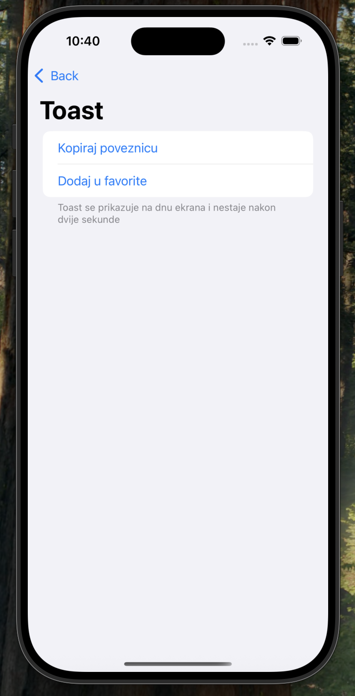
  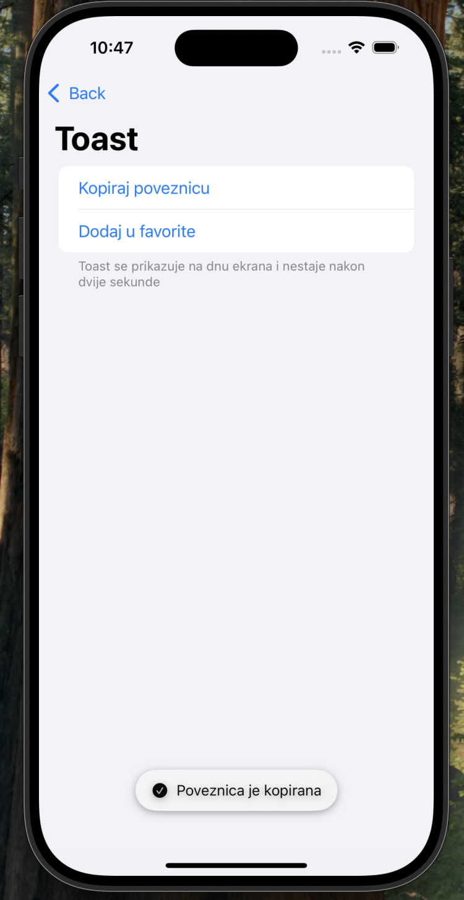
</p>

[↑ Natrag na sadržaj](#sadržaj)

## Korak 3: Snackbar

Snackbar je kratka poruka koja se prikazuje na dnu ekrana i obavještava korisnika o radnji koju je aplikacija napravila. Kao i toast, nemodalan je i nakon nekoliko sekundi sam nestaje. Razlika je u tome što snackbar može ponuditi **jednu akciju**, najčešće „Poništi“ ili „Pokušaj ponovno“.

Snackbar potječe iz Material Designa, Googleovog sustava za dizajn. U iOS-u ne postoji kao gotova komponenta pa se implementira kao vlastiti view na sličan način kao toast u prethodnom koraku.

U Koraku 1 navedena je preporuka da se alert ne prikazuje za česte radnje koje se mogu poništiti. Umjesto pitanja „Jeste li sigurni?“ prije brisanja, aplikacija može odmah obrisati stavku i ponuditi snackbar s gumbom „Poništi“. Korisnika se ne prekida, a pogreška se lako ispravlja.

**Dijelovi snackbara:**
1. **spremnik**: pozadina na dnu ekrana
2. **tekst poruke**: jedan do dva retka
3. **akcija** (neobavezno): jedan tekstualni gumb
4. **gumb za zatvaranje** (neobavezno)

### Preporuke dizajna

Preporuke su preuzete iz Material Designa i Androidove dokumentacije,
prilagođene iOS-u:

- **Jedan snackbar odjednom.** Nova poruka zamjenjuje prethodnu, snackbarovi se ne slažu jedan na drugi.
- **Najviše jedna akcija.** Gumb za zatvaranje je neobavezan. Ako je potrebno više izbora, koristi dijalog.
- **Kratak tekst**, jedan do dva retka.
- **Niski prioritet.** Snackbar ne prekida korisnika i ne traži reakciju. Za važne informacije koristi alert.
- **Ne zaklanjaj važne elemente.** Snackbar ne smije prekrivati navigaciju ni FAB; ako na ekranu postoji FAB, snackbar se prikazuje iznad njega. _(O FAB-u više riječi u Koraku #4)_
- **Razmak od rubova.** Snackbar drži stalnu udaljenost od lijevog, desnog i donjeg ruba ekrana.
- **Akcija ne smije biti jedini put do funkcije.** Ako korisnik propusti snackbar, i dalje mora moći doći do iste funkcije.
- **Pristupačnost.** Snackbar s akcijom ne bi smio nestati prije nego ga korisnik čitača ekrana stigne pronaći. Zato se, kad je uključen VoiceOver, ne skriva automatski.

### Korak 3.1: Model poruke

🔗 [Commit za ovaj korak](https://github.com/lsrbljino24/interakcija_s_korisnikom/commit/dcac302)

U mapi _Components_ napravi novu Swift datoteku _Snackbar.swift_:
```swift
import SwiftUI

struct Snackbar: Equatable {
    let id = UUID()
    let message: String
    var actionTitle: String? = nil
    var action: (() -> Void)? = nil

    static func == (lhs: Snackbar, rhs: Snackbar) -> Bool {
        lhs.id == rhs.id
    }
}
```
- _message_ je tekst poruke.
- _actionTitle_ i _action_ su naziv gumba i kod koji se izvršava kad ga korisnik dodirne. Oba su neobavezna (_?_), pa snackbar može postojati i bez akcije.
- _action_ je **closure** (funkcija spremljena u varijablu). Swift ne može sam usporediti dvije funkcije, pa se _Equatable_ ne može dobiti automatski. Zato je usporedba (_==_) napisana ručno. Dakle dva snackbara su jednaka ako imaju isti _id_.

### Korak 3.2: Izgled snackbara

🔗 [Commit za ovaj korak](https://github.com/lsrbljino24/interakcija_s_korisnikom/commit/9fbf360)

U istu datoteku dodaj view:

```swift
struct SnackbarView: View {
    let snackbar: Snackbar
    let onDismiss: () -> Void

    var body: some View {
        HStack(spacing: 12) {
            Text(snackbar.message)
                .font(.subheadline)
                .foregroundStyle(Color(.systemBackground))
                .frame(maxWidth: .infinity, alignment: .leading)

            if let actionTitle = snackbar.actionTitle {
                Button(actionTitle) {
                    snackbar.action?()
                    onDismiss()
                }
                .font(.subheadline.bold())
            }

            Button {
                onDismiss()
            } label: {
                Image(systemName: "xmark")
                    .foregroundStyle(Color(.systemBackground))
            }
            .accessibilityLabel("Zatvori")
        }
        .padding(.horizontal, 16)
        .padding(.vertical, 14)
        .background(.primary, in: RoundedRectangle(cornerRadius: 12))
        .shadow(radius: 4, y: 2)
    }
}

#Preview {
    SnackbarView(
        snackbar: Snackbar(message: "Poruka je obrisana", actionTitle: "Poništi"),
        onDismiss: {}
    )
    .padding()
}
```

- _onDismiss_ je funkcija koju view poziva kad se snackbar treba zatvoriti. Sam view ne zna kako se skriva, a to odlučuje modifikator u sljedećem koraku.
- Pozadina je u obrnutim bojama od ekrana: _.primary_ je tamna u svijetlom načinu rada i svijetla u tamnom, a tekst je u boji pozadine ekrana (_systemBackground_). Tako se snackbar jasno ističe iznad sadržaja, kao što preporučuje Material Design.
- Gumb akcije koristi naglasnu boju aplikacije i podebljani tekst kako bi se razlikovao od poruke.
- Dodir na akciju prvo izvrši akciju (_snackbar.action?()_), a zatim zatvori snackbar. Upitnik znači: pozovi funkciju samo ako postoji.
- _frame(maxWidth: .infinity)_ rasteže tekst, pa snackbar zauzima cijelu dostupnu širinu, a gumbi ostaju desno.
- Gumb za zatvaranje prikazuje samo ikonu, pa mu _.accessibilityLabel_ daje naziv koji VoiceOver izgovara.

<p align="center">
  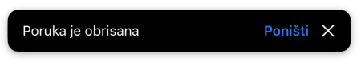
</p>

### Korak 3.3: Prikaz na ekranu

🔗 [Commit za ovaj korak](https://github.com/lsrbljino24/interakcija_s_korisnikom/commit/434d7b4)

Kao i toast, snackbar se prikazuje pomoću modifikatora. U istu datoteku
dodaj:

```swift
struct SnackbarModifier: ViewModifier {
    @Binding var snackbar: Snackbar?

    func body(content: Content) -> some View {
        content
            .overlay(alignment: .bottom) {
                if let snackbar {
                    SnackbarView(snackbar: snackbar) {
                        self.snackbar = nil
                    }
                    .padding(.horizontal, 16)
                    .padding(.bottom, 16)
                    .transition(.move(edge: .bottom).combined(with: .opacity))
                }
            }
            .animation(.easeInOut(duration: 0.3), value: snackbar)
    }
}

extension View {
    func snackbar(_ snackbar: Binding<Snackbar?>) -> some View {
        modifier(SnackbarModifier(snackbar: snackbar))
    }
}
```
Struktura je ista kao kod toasta. Jednie razlike su da _SnackbarView_ dobiva funkciju koja postavlja _snackbar_ na _nil_, pa ga zatvaraju gumb akcije i gumb za zatvaranje i da _padding(.horizontal, 16)_ drži razmak od rubova ekrana.

### Korak 3.4: Automatski nestanak i pristupačnost

🔗 [Commit za ovaj korak](https://github.com/lsrbljino24/interakcija_s_korisnikom/commit/14a1d63)


Snackbar sam nestaje nakon četiri sekunde, dulje od toasta jer korisnik
treba vremena da pročita poruku i odluči hoće li dodirnuti akciju. Ako je uključen VoiceOver, snackbar ostaje dok ga korisnik ne zatvori.

U _SnackbarModifier_ dodaj varijablu okruženja na vrh structa:
```swift
@Environment(\.accessibilityVoiceOverEnabled) private var voiceOverEnabled
```
Na _SnackbarView_, ispod _.transition_, dodaj:
```swift
.task(id: snackbar) {
    AccessibilityNotification.Announcement(snackbar.message).post()
    guard !voiceOverEnabled else { return }
    try? await Task.sleep(for: .seconds(4))
    guard !Task.isCancelled else { return }
    self.snackbar = nil
}
```

- _@Environment(\.accessibilityVoiceOverEnabled)_ čita sistemsku postavku koja govori je li na uređaju uključen VoiceOver.
- _AccessibilityNotification.Announcement_ izgovara poruku, isto kao kod toasta.
- _guard !voiceOverEnabled else { return }_ prekida zadatak prije odbrojavanja ako je VoiceOver uključen, pa snackbar ostaje vidljiv i korisnik može pronaći gumb akcije.
- Ostatak je isti kao kod toasta. Dakle čeka se, a zatim se snackbar skriva osim ako ga je u međuvremenu zamijenila nova poruka.

### Korak 3.5: Korištenje na ekranu

🔗 [Commit za ovaj korak](https://github.com/lsrbljino24/interakcija_s_korisnikom/commit/4d9e011)

Ekran prikazuje listu poruka. Kad korisnik obriše poruku, ona se odmah uklanja, a snackbar nudi poništavanje. 

Zamijeni sadržaj datoteke _Screens/SnackbarScreen.swift_:
```swift
import SwiftUI

struct SnackbarScreen: View {
    @State private var messages = [
        "Sastanak u 10 sati",
        "Račun za studeni",
        "Potvrda rezervacije",
        "Pozivnica za rođendan",
        "Novi komentar na objavu"
    ]
    @State private var snackbar: Snackbar?

    var body: some View {
        List {
            Section {
                ForEach(messages, id: \.self) { message in
                    Label(message, systemImage: "envelope")
                }
                .onDelete(perform: deleteMessage)
            } footer: {
                Text("Povuci poruku ulijevo kako bi je obrisao.")
            }
        }
        .navigationTitle("Snackbar")
        .snackbar($snackbar)
    }

    private func deleteMessage(at offsets: IndexSet) {
        guard let index = offsets.first else { return }
        let deletedMessage = messages.remove(at: index)

        snackbar = Snackbar(message: "Poruka je obrisana", actionTitle: "Poništi") {
            withAnimation {
                messages.insert(deletedMessage, at: index)
            }
        }
    }
}

#Preview {
    NavigationStack {
        SnackbarScreen()
    }
}
```
- _.onDelete_ omogućuje brisanje povlačenjem retka ulijevo i poziva funkciju _deleteMessage_ s indeksom obrisanog retka.
- _deleteMessage_ uklanja poruku iz liste, ali je pamti (_deletedMessage_) zajedno s njezinim položajem (_index_).
- Snackbar dobiva akciju „Poništi“. Njegov closure vraća poruku na isto mjesto u listi, a _withAnimation_ animira njezin povratak.
- Brisanje se događa odmah bez potvrde (npr. alerta) jer se može poništiti.

Sada možemo pokrenuti aplikaciju i povući poruku ulijevo i obrisati je. Pojavljuje se snackbar koji traje četiri sekunde na kojemu možemo odabrati opciju **Poništi** nakon čega se poruka vraća na svoje mjesto. S druge strane možemo pričekati četiri sekunde nakon čega snackbar nestaje.

<p align="center">
  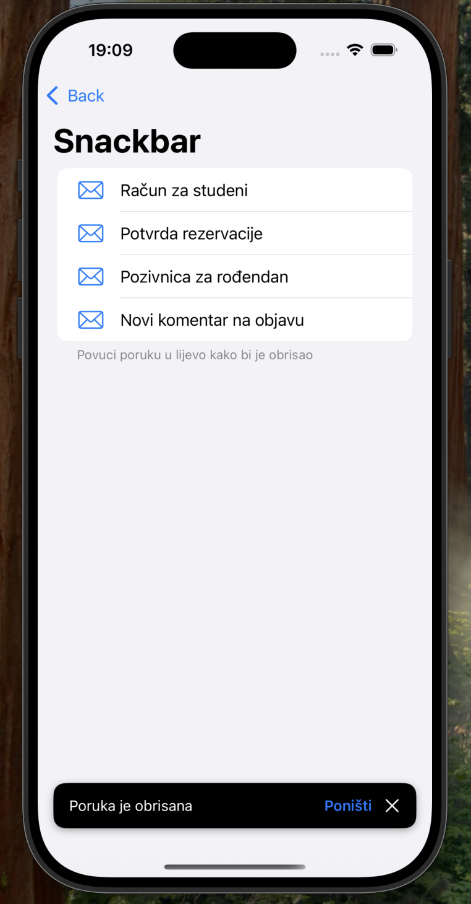
</p>

[↑ Natrag na sadržaj](#sadržaj)

  
## Korak 4: FAB

FAB (_Floating Action Button_, plutajući gumb za radnju) je okrugli gumb s ikonom koji „lebdi“ iznad sadržaja ekrana, najčešće u donjem desnom kutu. Predstavlja glavnu radnju ekrana, tj. onu koju korisnik najčešće izvodi, npr. novu poruku, novu bilješku ili novi kontakt.

FAB ne prikazuje poruku korisniku za razliku od prethodnih elemenata nego je stalno dostupna točka iz koje korisnik pokreće neku interakciju. Zato se često kombinira s ostalim elementima, npr. FAB otvara dijalog ili obrazac, a rezultat radnje se potvrđuje toastom ili snackbarom.

FAB postoji u dva oblika:
- **standardni**: okrugli gumb sa samo ikonom
- **prošireni**: gumb s ikonom i tekstom za slučajeve kad ikona sama nije dovoljno jasna

FAB je dio Material Designa i iOS ga nema kao gotovu komponentu. Appleove aplikacije glavnu radnju obično stavljaju u navigacijsku ili alatnu traku. Međutim FAB se na iOS-u ipak koristi, posebno u aplikacijama koje dijele dizajn između Androida i iOS-a.

### Preporuke dizajna

Preporuke iz Material Designa:
- **Samo za glavnu radnju.** FAB koristi samo ako ekran ima jednu jasnu glavnu radnju. Ne treba ga svaki ekran.
- **Jedan FAB po ekranu.** Više FAB-ova smanjuje njihovu istaknutost i zbunjuje korisnika.
- **Pozitivne radnje.** FAB služi za stvaranje, dodavanje ili dijeljenje, a ne za brisanje ili sporedne radnje.
- **Jasna ikona.** Ikona mora biti razumljiva sama po sebi (npr. `+` za dodavanje). Ako nije, koristi prošireni FAB s tekstom.
- **Veličina** standardnog FAB-a je 56 × 56.
- **Snackbar iznad FAB-a.** Kad su oba prikazana, snackbar ne smije  prekriti FAB.

Preporuke iz Apple Human Interface Guidelines:
- **Područje dodira** gumba mora biti najmanje 44 × 44 pt. FAB od 56 pt to zadovoljava.
- **Najviše jedan do dva istaknuta gumba po prikazu.** FAB je obojen i istaknut, pa uz njega ne treba drugih istaknutih gumba.
- **Pristupačnost.** Gumb sa samo ikonom mora imati tekstualni naziv za VoiceOver.

### Korak 4.1: Komponenta FAB

🔗 [Commit za ovaj korak](https://github.com/lsrbljino24/interakcija_s_korisnikom/commit/8bd0a48)

U mapi _Components_ napravi novu Swift datoteku _FloatingActionButton.swift_:
```swift
import SwiftUI

struct FloatingActionButton: View {
    let title: String
    let systemImage: String
    let action: () -> Void

    var body: some View {
        Button(action: action) {
            Image(systemName: systemImage)
                .font(.title2.weight(.semibold))
                .frame(width: 56, height: 56)
                .foregroundStyle(.white)
                .background(.tint, in: Circle())
                .shadow(radius: 6, y: 3)
        }
        .accessibilityLabel(title)
    }
}

#Preview {
    FloatingActionButton(title: "Nova bilješka", systemImage: "plus") {}
}
```

- _title_ je naziv radnje. Ne prikazuje se na gumbu, ali ga _.accessibilityLabel_ predaje VoiceOveru pa korisnik čuje
  „Nova bilješka“ umjesto „plus“.
- _systemImage_ je ikona iz SF Symbols, a _action_ kod koji se izvršava na dodir.
- _.frame(width: 56, height: 56)_ daje FAB-u standardnu veličinu iz Material Designa.
- _.background(.tint, in: Circle())_ crta krug u naglašenoj boji aplikacije.
- _.shadow_ odvaja FAB od sadržaja i daje dojam da lebdi iznad njega.


### Korak 4.2: FAB na ekranu

🔗 [Commit za ovaj korak](https://github.com/lsrbljino24/interakcija_s_korisnikom/commit/e8041ed)

Na testnom ekranu prikazana je lista bilješki, a FAB dodaje novu. 
Zamijeni sadržaj datoteke _FABScreen.swift_:
```swift
import SwiftUI

struct FABScreen: View {
    @State private var notes = ["Bilješka 1", "Bilješka 2", "Bilješka 3"]

    var body: some View {
        List(notes, id: \.self) { note in
            Text(note)
        }
        .navigationTitle("FAB")
        .safeAreaInset(edge: .bottom, alignment: .trailing) {
            FloatingActionButton(title: "Nova bilješka", systemImage: "plus") {
                withAnimation {
                    notes.append("Bilješka \(notes.count + 1)")
                }
            }
            .padding(16)
        }
    }
}

#Preview {
    NavigationStack {
        FABScreen()
    }
}
```
- _.safeAreaInset(edge: .bottom, alignment: .trailing)_ postavlja FAB na dno ekrana uz desni rub i istovremeno povećava donji razmak liste za visinu FAB-a. Zato se zadnja bilješka može pomaknuti iznad FAB-a i ne ostaje skrivena ispod njega.
- _withAnimation_ animira pojavljivanje nove bilješke na ekran.

Kako bi testirao, pokreni aplikaciju i klikni na FAB odnosno na gumb _+_ čime se dodaje nova bilješka. Probaj dodati više bilješki u listu i pogledaj što će se sa FAB-om dogoditi.

<p align="center">
  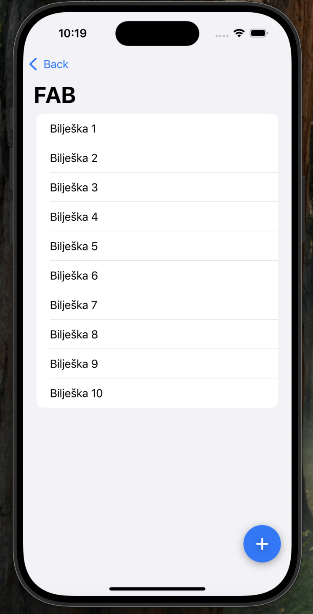
</p>

[↑ Natrag na sadržaj](#sadržaj)


## Korak 5: Sistemske notifikacije

Sistemske notifikacije prikazuje operacijski sustav, a ne aplikacija. Zato mogu stići i kad aplikacija nije otvorena, npr. na zaključanom zaslonu, kao natpis na vrhu ekrana i u Centru za obavijesti.

Postoje dvije vrste notifikacija:
- **lokalne**: zakazuje ih sama aplikacija na uređaju 
- **udaljene**: šalje ih poslužitelj preko Appleovog servisa

U ovome tutorialu obrađujemo lokalne notifikacije, koje ne trebaju poslužitelj i rade u simulatoru.

Za rad s notifikacijama koristi se framework **UserNotifications**.
Glavni dijelovi su:

| Dio | Uloga |
|---|---|
| _UNUserNotificationCenter_ | središnji objekt koji traži dozvolu, zakazuje notifikacije i prima reakcije |
| _UNMutableNotificationContent_ | za naslov, tekst, zvuk, slika |
| _UNTimeIntervalNotificationTrigger_ | služi kao okidač: kada se notifikacija prikazuje |
| _UNNotificationRequest_ | to je zahtjev koji spaja sadržaj i okidač |
| _UNUserNotificationCenterDelegate_ | prima reakcije korisnika na notifikacije |

Korisnik na notifikaciju može reagirati na više načina:
- **dodirom**: tada se može otvoriti aplikacija
- **gumbom akcije**: tada se može izvesti neka radnja bez otvaranja aplikacije
- **zatvaranjem**: notifikacija se odbacuje

### Preporuke dizajna

Preporuke su preuzete iz Apple Human Interface Guidelines:
- **Dozvola je obavezna.** Prije slanja notifikacija aplikacija mora dobiti pristanak korisnika. Dobra praksa je tražiti ga u trenutku kad korisnik prvi put zatraži nešto što notifikacije treba, kako bi razumio zašto se traži.
- **Kratko i informativno.** Notifikacija treba prenijeti vrijednu informaciju koja se razumije na prvi pogled.
- **Bez ponavljanja.** Ne šalji više notifikacija za istu stvar.
- **Ne za greške.** Poruku o grešci prikaži alertom unutar aplikacije.
- **Obradi notifikacije dok je aplikacija otvorena.** Sustav ih tada po defaultu ne prikazuje, pa aplikacija mora odlučiti što s njima.
- **Korisne akcije.** Gumbi na notifikaciji trebaju nuditi radnje koje korisniku štede vrijeme, npr. odgodu podsjetnika ili odgovor na pozivnicu.
- **Zvuk** pomaže da korisnik primijeti notifikaciju kad ne gleda u ekran.

### Korak 5.1: Upravitelj notifikacija

🔗 [Commit za ovaj korak](https://github.com/lsrbljino24/interakcija_s_korisnikom/commit/8f9f534)

Na početku tutoriala smo napravili mapu _Notifications_ u koju ćemo sada smjestiti klasu gdje će se nalaziti sav kod za notifikacije, jednostavne i složene.

U mapi _Notifications_ kreiraj novu Swift datoteku _NotificationManager.swift_:
```swift
import UserNotifications
import Observation

@MainActor
@Observable
final class NotificationManager: NSObject {
    static let shared = NotificationManager()

    var lastAction = "Još nema reakcije na notifikaciju."

    private let center = UNUserNotificationCenter.current()

    func requestAuthorization() async -> Bool {
        let granted = (try? await center.requestAuthorization(options: [.alert, .sound])) ?? false
        if !granted {
            lastAction = "Notifikacije nisu dopuštene. Uključi ih u Postavkama."
        }
        return granted
    }
}
```
- _@Observable_ omogućuje da se ekran automatski osvježi kad se promijeni _lastAction_, tj. zadnja reakcija korisnika.
- _static let shared_ je jedna zajednička instanca koju koriste aplikacija i oba ekrana.
- _NSObject_ koristimo jer klasa kasnije postaje delegat notifikacijskog centra.
- _requestAuthorization_ prikazuje sistemski upit za dozvolu. Upit se prikazuje samo prvi put, a kasnije metoda samo vraća korisnikovu odluku. _options_ određuje što aplikacija smije, u našem slučaju prikazivati notifikacije i puštati zvuk.

### Korak 5.2: Jednostavna notifikacija

🔗 [Commit za ovaj korak](https://github.com/lsrbljino24/interakcija_s_korisnikom/commit/804bb73)

U _NotificationManager_ dodaj dvije metode:

```swift
func sendSimpleNotification() async {
    guard await requestAuthorization() else { return }

    let content = UNMutableNotificationContent()
    content.title = "Podsjetnik"
    content.body = "Vrijeme je za kratku pauzu."
    content.sound = .default

    await schedule(content)
}

private func schedule(_ content: UNNotificationContent) async {
    let trigger = UNTimeIntervalNotificationTrigger(timeInterval: 5, repeats: false)
    let request = UNNotificationRequest(
        identifier: UUID().uuidString,
        content: content,
        trigger: trigger
    )
    try? await center.add(request)
}
```
- Dozvola se traži tek kad korisnik prvi put pošalje notifikaciju u skladu s preporukom.
- _content_ sadrži naslov, tekst i zadani zvuk.
- Okidač prikazuje notifikaciju nakon 5 sekundi, samo jednom jer smo stavili _repeats: false_.
- Svaki zahtjev ima jedinstveni _identifier_ pa nova notifikacija ne zamjenjuje prethodnu.
- _schedule_ je zasebna metoda jer će je koristiti i složena notifikacija pa smo je izdvojili da se ne ponavlja.

Zamijeni sadržaj _SimpleNotificationScreen.swift_:
```swift
import SwiftUI

struct SimpleNotificationScreen: View {
    private let manager = NotificationManager.shared

    var body: some View {
        List {
            Section {
                Button("Pošalji notifikaciju za 5 sekundi") {
                    Task { await manager.sendSimpleNotification() }
                }
            } footer: {
                Text("Nakon slanja možeš otići na početni zaslon (Cmd+Shift+H) i pričekati notifikaciju.")
            }

            Section("Zadnja reakcija korisnika") {
                Text(manager.lastAction)
                    .foregroundStyle(.secondary)
            }
        }
        .navigationTitle("Jednostavna notifikacija")
    }
}
```

- _Task { }_ pokreće asinkroni kod iz gumba, jer gumb sam ne može čekati.

Pokreni aplikaciju, dodirni gumb i dopusti notifikacije. Zatim idi na početni zaslon simulatora (**Cmd+Shift+H**) i pričekaj notifikaciju.

<p align="center">
  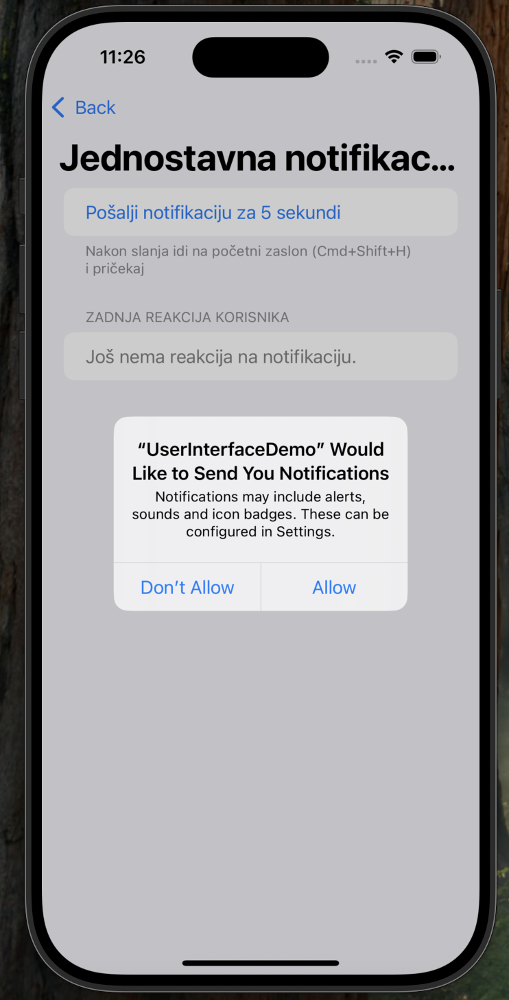
  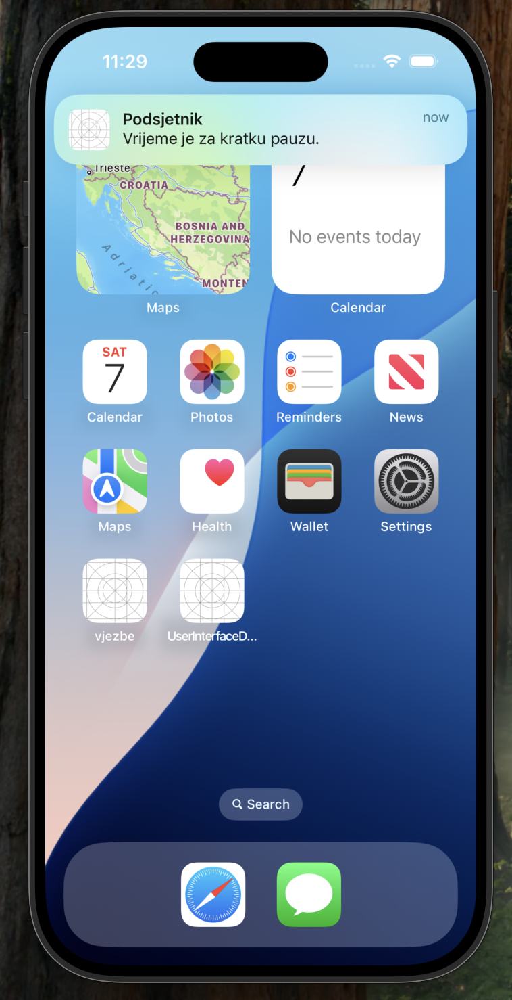
</p>

### Korak 5.3: Prikaz u aplikaciji i obrada dodira

🔗 [Commit za ovaj korak](https://github.com/lsrbljino24/interakcija_s_korisnikom/commit/4743408)

Sada trebamo implementirati delegat notifikacijskog centra kako bi se notifikacija mogla prikazivati kad je aplikacija otvorena i kako bi aplikacija mogla znati kada korisnik dodirne notifikaciju.


U _NotificationManager_ odmah ispod varijabli dodaj metodu koja klasu postavlja kao delegat:

```swift
func setUp() {
    center.delegate = self
}
```
Na dno datoteke ispod klase dodaj:
```swift
extension NotificationManager: UNUserNotificationCenterDelegate {
    nonisolated func userNotificationCenter(
        _ center: UNUserNotificationCenter,
        willPresent notification: UNNotification
    ) async -> UNNotificationPresentationOptions {
        [.banner, .sound]
    }

    nonisolated func userNotificationCenter(
        _ center: UNUserNotificationCenter,
        didReceive response: UNNotificationResponse
    ) async {
        await handleAction(response.actionIdentifier)
    }

    private func handleAction(_ identifier: String) {
        switch identifier {
        case UNNotificationDefaultActionIdentifier:
            lastAction = "Korisnik je dodirnuo notifikaciju."
        default:
            break
        }
    }
}
```
- _willPresent_ se poziva kad notifikacija stigne dok je aplikacija otvorena. Vraćanjem _[.banner, .sound]_ notifikacija se prikazuje i tada.
- _didReceive_ se poziva kad korisnik reagira na notifikaciju. _actionIdentifier_ govori što je korisnik napravio, a _UNNotificationDefaultActionIdentifier_ znači da je dodirnuo samu notifikaciju.
- ove metode su označene s _nonisolated_ jer ih sustav poziva izvan glavne niti. _handleAction_ se poziva s _await_ jer mijenja _lastAction_ što se smije samo na glavnoj niti.

Delegat mora biti postavljen čim se aplikacija pokrene pa u _UserInterfaceDemoApp.swift_ dodaj inicijalizator:

```swift
@main
struct UserInterfaceDemoApp: App {
    init() {
        NotificationManager.shared.setUp()
    }

    var body: some Scene {
        WindowGroup {
            ContentView()
        }
    }
}
```

Kako bi testirao, pokreni aplikaciju, pošalji notifikaciju i ostani u aplikaciji. Pošalji notifikaciju idi na početni zaslon i dodirni je. Trebala bi se otvoriti aplikacija i na ekranu ispisati „Korisnik je dodirnuo notifikaciju.“


### Korak 5.4: Slika za složenu notifikaciju

🔗 [Commit za ovaj korak](https://github.com/lsrbljino24/interakcija_s_korisnikom/commit/8fb9a57)

Složena notifikacija prikazuje sliku. Slika mora biti datoteka u projektu, a ne u katalogu _Assets_, jer sustav treba stvarnu putanju do datoteke, a slike iz kataloga je nemaju.

Postavi sliku (npr. _profl.png_) u mapu _Notifications_ u Xcodeu. 

### Korak 5.5: Složena notifikacija: slika i gumbi

🔗 [Commit za ovaj korak](https://github.com/lsrbljino24/interakcija_s_korisnikom/commit/259157e)

Gumbi na notifikaciji definiraju se unaprijed i grupiraju u kategoriju. Notifikacija zatim navodi svoju kategoriju, a sustav uz nju prikazuje gumbe te kategorije.

Proširi _setUp_ registracijom kategorije s dva gumba:
```swift
func setUp() {
    center.delegate = self

    let accept = UNNotificationAction(identifier: "ACCEPT", title: "Prihvati", options: [])
    let decline = UNNotificationAction(identifier: "DECLINE", title: "Odbij", options: [.destructive])

    let invitation = UNNotificationCategory(
        identifier: "INVITATION",
        actions: [accept, decline],
        intentIdentifiers: [],
        options: []
    )
    center.setNotificationCategories([invitation])
}
```
- _UNNotificationAction_ je jedan gumb. _identifier_ služi aplikaciji da prepozna koji je gumb dodirnut, a _title_ je tekst na gumbu.
- _.destructive_ prikazuje gumb crveno isto kao uloga gumba u dijalozima.
- _UNNotificationCategory_ grupira gumbe pod imenom _INVITATION_.

Dodaj metodu za slanje složene notifikacije ispod _sendSimpleNotification_:
```swift
func sendRichNotification() async {
    guard await requestAuthorization() else { return }

    let content = UNMutableNotificationContent()
    content.title = "Pozivnica"
    content.body = "Ana te poziva na rođendansku proslavu u subotu."
    content.sound = .default
    content.categoryIdentifier = "INVITATION"

    if let url = Bundle.main.url(forResource: "profil", withExtension: "png"),
       let attachment = try? UNNotificationAttachment(identifier: "slika", url: url, options: nil) {
        content.attachments = [attachment]
    }

    await schedule(content)
}
```
- _categoryIdentifier = "INVITATION"_ povezuje notifikaciju s kategorijom, pa se prikazuju gumbi „Prihvati“ i „Odbij“.
- _Bundle.main.url_ pronalazi sliku u aplikaciji, a _UNNotificationAttachment_ je pretvara u privitak notifikacije.
- Ako slika ne postoji notifikacija se šalje bez nje.

### Korak 5.6: Obrada akcija

🔗 [Commit za ovaj korak](https://github.com/lsrbljino24/interakcija_s_korisnikom/commit/6984fb4)

Proširi _handleAction_ slučajevima za oba gumba:

```swift
private func handleAction(_ identifier: String) {
    switch identifier {
    case UNNotificationDefaultActionIdentifier:
        lastAction = "Korisnik je dodirnuo notifikaciju."
    case "ACCEPT":
        lastAction = "Korisnik je prihvatio pozivnicu."
    case "DECLINE":
        lastAction = "Korisnik je odbio pozivnicu."
    default:
        break
    }
}
```
Zamijeni sadržaj _RichNotificationScreen.swift_:

```swift
import SwiftUI

struct RichNotificationScreen: View {
    private let manager = NotificationManager.shared

    var body: some View {
        List {
            Section {
                Button("Pošalji pozivnicu za 5 sekundi") {
                    Task { await manager.sendRichNotification() }
                }
            } footer: {
                Text("Dugo pritisni notifikaciju ili je povuci prema dolje za prikaz slike i gumba.")
            }

            Section("Zadnja reakcija korisnika") {
                Text(manager.lastAction)
                    .foregroundStyle(.secondary)
            }
        }
        .navigationTitle("Složena notifikacija")
    }
}
```

Kako bi testirao, pokreni aplikaciju, pozovi složenu notifikaciju i povuci prema dolje kako bi prikazao veliku sliku notifikacije i gumbe "Prihvati" i "Odbij". Dodir na gumbe ne otvara aplikaciju nego postavi zadnju reakciju korisnika na ekranu.

<p align="center">
  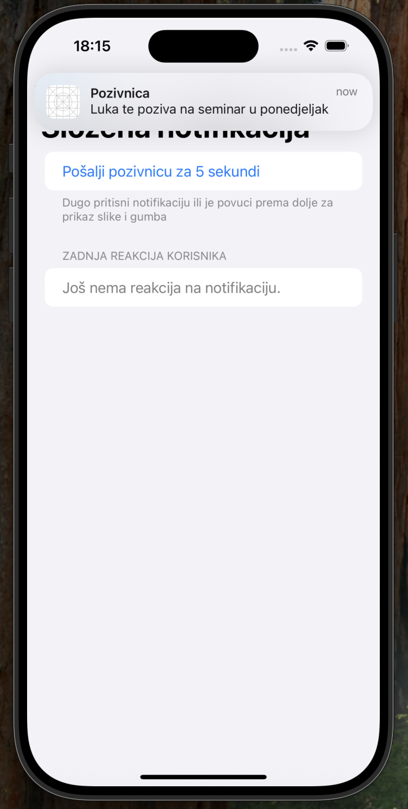
  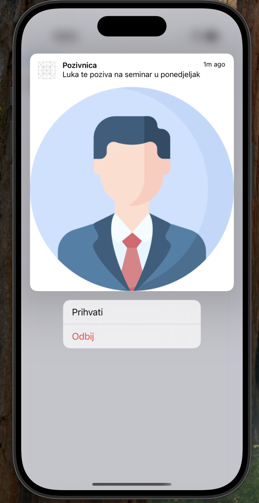
</p>

[↑ Natrag na sadržaj](#sadržaj)


## Zaključak

Aplikacija s korisnikom komunicira na više načina, a na nama je da odredimo kojoj situaciji ide koji način. Važno je uskladiti važnost poruke s razinom prekidanja korisnika. Dakle za važne odluke poželjan je dijalog, za kratke toast ili snackbar, a događaji izvan aplikacije traže sistemske notifikacije.

Dijalozi i notifikacije su ugrađeni u iOS, dok su toast, snackbar i FAB preuzeti iz Material Designa i implementirani kao vlastite komponente. Pri njihovoj izradi važno je bilo pratiti preporuke dizajna i pristupačnosti.

| Element | Prekida korisnika | Traži reakciju | Broj akcija | Nestaje sam | Radi izvan aplikacije | Gotova komponenta u iOS-u | Kada koristiti |
|---|---|---|---|---|---|---|---|
| Alert | da | da | do 3 | ne | ne | da | važna informacija ili potvrda nepovratne radnje |
| Confirmation dialog | da | da | više izbora + odustani | ne | ne | da | izbor između više radnji koje je korisnik pokrenuo |
| Sheet | djelomično | da | proizvoljno | ne | ne | da | kratak zadatak, npr. obrazac |
| Toast | ne | ne | 0 | da | ne | ne | kratka potvrda radnje |
| Snackbar | ne | ne | 1 | da | ne | ne | potvrda radnje uz mogućnost poništavanja |
| FAB | ne | – | 1 | ne | ne | ne | glavna radnja ekrana |
| Notifikacija | ne | ne | dodir + do više gumba | ne | da | da | događaj kad aplikacija nije otvorena |

[↑ Natrag na sadržaj](#sadržaj)


## Literatura

Android Developers. (bez dat.). *Toasts overview*. Pristupano 04.11.2026. na https://developer.android.com/guide/topics/ui/notifiers/toasts

Apple Inc. (bez dat.-a). *Apple Developer Documentation* (SwiftUI, UserNotifications, Accessibility). Pristupano 04.11.2026. na https://developer.apple.com/documentation/

Apple Inc. (bez dat.-b). *Human Interface Guidelines* (Alerts, Action sheets, Sheets, Feedback, Buttons, Notifications, Managing notifications). Pristupano 05.11.2026. na https://developer.apple.com/design/human-interface-guidelines/

Apple Inc. (bez dat.-c). *SF Symbols*. Pristupano 05.11.2026. na https://developer.apple.com/sf-symbols/

Apple Inc. (bez dat.-d). *SwiftUI Tutorials*. Pristupano 05.11.2026. na https://developer.apple.com/tutorials/swiftui

Google. (bez dat.). *Material Design 3* (Snackbars, Floating action button). Pristupano 06.11.2026. na https://m3.material.io/

JetBrains. (bez dat.). *Snackbar*. Compose Multiplatform API reference. Pristupano 06.11.2026. na https://kotlinlang.org/api/compose-multiplatform/material3/androidx.compose.material3/-snackbar.html

Swift.org. (bez dat.). *Swift documentation* (A Swift Tour, Swift API Design Guidelines). Pristupano 05.11.2026. na https://www.swift.org/documentation/

[↑ Natrag na sadržaj](#sadržaj)
